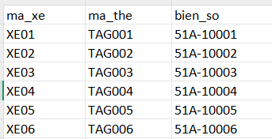
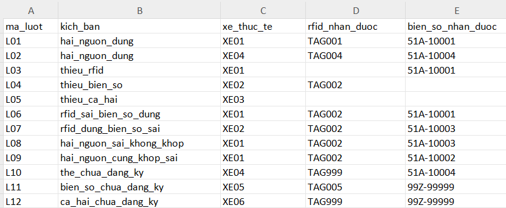

# CHƯƠNG 6. Ứng dụng mô phỏng đánh giá các phương án nhận diện phương tiện trong hệ thống ETC

## 6.1. Giới thiệu mục tiêu, phạm vi và dữ liệu mô phỏng

### 6.1.1. Mục tiêu mô phỏng

Phần mô phỏng được xây dựng nhằm minh họa và so sánh cách xử lý thông tin nhận diện phương tiện của ba phương án: RFID riêng lẻ, ANPR/LPR riêng lẻ và phối hợp RFID–ANPR/LPR. Ba phương án sử dụng chung một bộ dữ liệu giả lập để việc đối chiếu được thực hiện trên cùng các lượt xe.

Thông qua những tình huống thông tin đầy đủ, thiếu, sai hoặc không khớp, mô hình cho phép xem xét khả năng trả về đúng định danh phương tiện và xác định các trường hợp cần chuyển sang xác minh. Kết quả xử lý được dùng để bổ sung minh họa cho nội dung phân tích công nghệ và tình huống ở chương 4–5.

Mục tiêu của mô hình là kiểm tra quy tắc tra cứu và đối chiếu thông tin. Mô hình không được sử dụng để xác định độ chính xác thực tế của thiết bị RFID hoặc thuật toán nhận dạng biển số.

### 6.1.2. Phạm vi và công cụ mô phỏng

Mô hình mô phỏng được xây dựng bằng ngôn ngữ lập trình Python, với các chức năng chính gồm tạo dữ liệu phương tiện giả lập, xử lý thông tin nhận diện và tổng hợp kết quả. Chương trình được thực hiện trên terminal, sử dụng các thư viện của Python để quản lý và lưu trữ dữ liệu dưới định dạng CSV. Cách triển khai này giúp đơn giản hóa quá trình xây dựng mô hình, đồng thời thuận tiện cho việc kiểm tra, đối chiếu và đánh giá kết quả giữa các phương án nhận diện.

Phạm vi mô phỏng bắt đầu từ kết quả đọc đã có sẵn:

- Đối với RFID, đầu vào là chuỗi mã thẻ giả lập để tra cứu trong danh sách đăng ký.
- Đối với ANPR/LPR, đầu vào là chuỗi biển số giả lập để tra cứu phương tiện tương ứng.
- Đối với phương án phối hợp, hai kết quả tra cứu của cùng một lượt xe được đối chiếu để đưa ra quyết định xử lý.

Mô hình không bao gồm quá trình truyền nhận tín hiệu vô tuyến, thu nhận và xử lý ảnh, giao dịch thanh toán hoặc điều khiển thanh chắn. Thông tin không khớp được xem là trường hợp cần kiểm tra, chưa đủ căn cứ để kết luận có hành vi gian lận.

Dữ liệu được thiết kế cố định, không sử dụng xác suất lỗi hoặc cơ chế sinh ngẫu nhiên. Khi không thay đổi nội dung chương trình, các lần chạy tạo ra cùng một bộ dữ liệu. Cách tổ chức này giúp các thành viên sử dụng chung đầu vào và đối chiếu lại kết quả.

Các giả định chính của mô hình gồm: mỗi xe đăng ký có một mã xe, một mã thẻ và một biển số duy nhất; mọi phương tiện thực tế trong các lượt thử nghiệm đều thuộc danh sách đăng ký; mã thẻ và biển số nhận được có thể bị thiếu, chỉ tới xe khác hoặc chưa có trong danh sách.

### 6.1.3. Xây dựng bộ dữ liệu phương tiện giả lập

Bộ dữ liệu gồm hai thành phần: danh sách phương tiện đăng ký và danh sách lượt xe thử nghiệm. Toàn bộ thông tin do nhóm tự xây dựng, không được thu thập từ phương tiện hoặc hệ thống thu phí thực tế.

Danh sách phương tiện:

Lượt xe:

#### a. Danh sách phương tiện đăng ký

Danh sách đăng ký gồm 6 phương tiện, từ XE01 đến XE06. Mỗi phương tiện có một mã thẻ RFID và một biển số tương ứng.

| Trường dữ liệu | Ý nghĩa | Ví dụ |
|---|---|---|
| ma_xe | Định danh phương tiện trong mô hình | XE01 |
| ma_the | Mã thẻ RFID đã đăng ký | TAG001 |
| bien_so | Biển số đã đăng ký của phương tiện | 51A-10001 |

Danh sách này đóng vai trò dữ liệu tham chiếu. Phương án RFID sử dụng quan hệ giữa ma_the và ma_xe; phương án ANPR/LPR sử dụng quan hệ giữa bien_so và ma_xe. Phương án phối hợp đối chiếu mã xe sau tra cứu, không so sánh trực tiếp chuỗi mã thẻ với chuỗi biển số.

#### b. Danh sách lượt xe thử nghiệm

Danh sách thử nghiệm gồm 12 lượt xe, từ L01 đến L12. Một phương tiện có thể xuất hiện trong nhiều lượt để kiểm tra các tình huống đọc khác nhau.

| Trường dữ liệu | Ý nghĩa |
|---|---|
| ma_luot | Mã duy nhất của lượt xe, dùng để ghép kết quả của cùng lượt |
| kich_ban | Tình huống được thiết kế cho lượt xe |
| xe_thuc_te | Định danh đúng của phương tiện, làm căn cứ đánh giá kết quả |
| rfid_nhan_duoc | Mã thẻ giả lập mà hệ thống nhận được |
| bien_so_nhan_duoc | Chuỗi biển số giả lập mà hệ thống nhận được |

Ô trống trong hai trường thông tin nhận được biểu thị tình huống không đọc được dữ liệu. Các giá trị TAG999 và 99Z-99999 được sử dụng để biểu thị thông tin chưa có trong danh sách đăng ký.

Ví dụ, lượt L06 có phương tiện thực tế là XE01, mã thẻ nhận được là TAG002 và biển số nhận được là 51A-10001. Khi đối chiếu danh sách đăng ký, mã thẻ chỉ tới XE02, còn biển số chỉ tới XE01. Lượt này minh họa trường hợp RFID cung cấp thông tin sai nhưng ANPR/LPR cung cấp thông tin đúng.

Trường xe_thuc_te chỉ được sử dụng sau khi phương án đã đưa ra quyết định để xác định kết quả đúng hoặc sai. Trường này không được truyền vào các hàm ra quyết định nhận diện.

### 6.1.4. Thiết lập các kịch bản và tiêu chí đánh giá

#### a. Các kịch bản thử nghiệm

Bộ thử nghiệm gồm 12 lượt thuộc 11 loại tình huống. Hai lượt đầu sử dụng các phương tiện khác nhau trong cùng tình huống hai nguồn đều đúng; các lượt còn lại tập trung vào những trường hợp thiếu, sai và chưa đăng ký.

| Lượt xe | Tình huống | Mục đích kiểm tra |
|---|---|---|
| L01–L02 | Hai nguồn cùng cung cấp thông tin đúng | Kiểm tra xử lý thông thường với các xe khác nhau |
| L03 | Không đọc được RFID, biển số đúng | Kiểm tra thiếu thông tin mã thẻ |
| L04 | RFID đúng, không đọc được biển số | Kiểm tra thiếu thông tin biển số |
| L05 | Không đọc được cả hai nguồn | Kiểm tra trường hợp không đủ dữ liệu nhận diện |
| L06 | RFID sai, biển số đúng | Kiểm tra đối chiếu khi mã thẻ chỉ tới xe khác |
| L07 | RFID đúng, biển số sai | Kiểm tra đối chiếu khi biển số chỉ tới xe khác |
| L08 | Hai nguồn cùng sai và chỉ tới hai phương tiện khác nhau | Kiểm tra bất đồng giữa hai nguồn |
| L09 | Hai nguồn cùng chỉ tới một phương tiện sai | Kiểm tra giới hạn của việc chỉ dựa vào sự trùng khớp |
| L10 | Mã thẻ chưa đăng ký, biển số đúng | Kiểm tra trường hợp không tra cứu được mã thẻ |
| L11 | RFID đúng, biển số chưa đăng ký | Kiểm tra trường hợp không tra cứu được biển số |
| L12 | Cả hai nguồn đều chưa đăng ký | Kiểm tra trường hợp không tra cứu được phương tiện từ cả hai nguồn |

#### b. Nguyên tắc so sánh và tiêu chí đánh giá

Ba phương án được chạy trên cùng 12 lượt xe và sử dụng chung danh sách đăng ký. Phương án RFID chỉ sử dụng thông tin mã thẻ; phương án ANPR/LPR chỉ sử dụng thông tin biển số. Trong mô hình phối hợp được lựa chọn, chỉ chấp nhận tự động khi cả hai nguồn đều tra cứu được và cùng chỉ tới một phương tiện; các trường hợp còn lại được chuyển xác minh.

Mỗi phương án đưa ra trạng thái xử lý, mã xe được chọn nếu có và lý do xử lý. Sau đó, kết quả được đối chiếu với xe_thuc_te và phân vào một trong ba nhóm:

| Nhóm kết quả | Điều kiện xác định |
|---|---|
| Định danh đúng tự động | Phương án chấp nhận tự động và trả về đúng xe_thuc_te |
| Chấp nhận sai | Phương án chấp nhận tự động nhưng trả về phương tiện khác xe_thuc_te |
| Chuyển xác minh | Phương án chưa chấp nhận định danh và yêu cầu kiểm tra bổ sung |

Tỷ lệ từng nhóm được tính theo công thức:

$$
T_g = \frac{n_g}{N} \times 100\%
$$

Trong đó:

- $T_g$ là tỷ lệ của nhóm kết quả $g$.
- $n_g$ là số lượt thuộc nhóm đó.
- $N$ là tổng số lượt thử nghiệm của mỗi phương án.

Với bộ dữ liệu hiện tại, $N = 12$.

Ba nhóm kết quả loại trừ nhau và bao phủ toàn bộ kết quả xử lý, nên tổng ba tỷ lệ bằng 100%, ngoại trừ sai khác do làm tròn. Chuyển xác minh không đồng nghĩa với định danh sai hoặc từ chối giao dịch; mô hình chưa đánh giá kết quả xử lý thủ công sau đó.

Việc triển khai và phân tích kết quả được trình bày trong các mục 6.2–6.5. Các chỉ số được xem xét đồng thời để thể hiện sự đánh đổi giữa xử lý tự động, chấp nhận sai và số lượt cần xác minh.

Do các tình huống được lựa chọn chủ động, bộ dữ liệu phục vụ kiểm tra các nhánh xử lý, không đại diện cho phân bố lỗi thực tế. Các tỷ lệ thu được chỉ có ý nghĩa trong phạm vi bộ thử nghiệm; không dùng để kết luận về độ chính xác, tốc độ, chi phí hoặc hiệu quả vận hành thực tế của công nghệ ETC.
