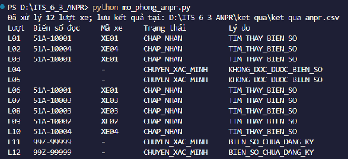
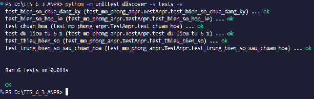
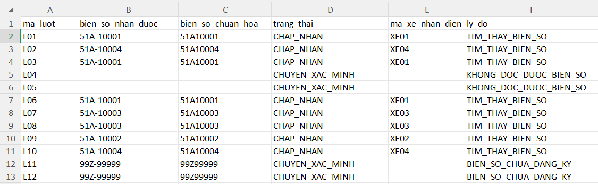

## **6.3 Mô phỏng nhận diện bằng ANPR/LPR** 

### **6.3.1. Mô hình đầu vào, quy tắc tra cứu và đầu ra** 

Trong phạm vi đề tài, phương án ANPR/LPR được mô phỏng ở giai đoạn tra cứu định danh phương tiện từ chuỗi biển số đã nhận được. Mô hình không thực hiện chụp ảnh, xác định vùng biển số hoặc nhận dạng ký tự từ ảnh. Cách tiếp cận này phù hợp với phạm vi dữ liệu giả lập đã xác định tại mục 6.1, nhằm kiểm tra quy tắc xử lý thông tin sau nhận diện.

Dữ liệu đầu vào gồm hai tệp CSV được xây dựng ở mục 6.1: xe\_dang\_ky.csv (các cột ma\_xe, ma\_the, bien\_so; mô-đun này chỉ sử dụng ma\_xe và bien\_so) và luot\_xe.csv (sử dụng ma\_luot, bien\_so\_nhan\_duoc). Cột xe\_thuc\_te chỉ dùng để đối chiếu, đánh giá sau khi chương trình ra quyết định; dữ liệu RFID không tham gia vào phương án ANPR/LPR độc lập.

Trước khi tra cứu, biển số được chuyển thành chữ hoa, loại bỏ khoảng trắng, dấu gạch nối và dấu chấm. Ví dụ: “51a-10001” được chuyển thành “51A10001”. Bước này chỉ chuẩn hóa cách biểu diễn chuỗi, không tự sửa ký tự bị nhận dạng sai.

Quy tắc xử lý gồm ba trường hợp: (1) biển số trống: trả về CHUYEN\_XAC\_MINH, lý do KHONG\_DOC\_DUOC\_BIEN\_SO; (2) biển số có giá trị nhưng không tồn tại trong danh sách đăng ký: trả về CHUYEN\_XAC\_MINH, lý do BIEN\_SO\_CHUA\_DANG\_KY; (3) biển số tồn tại trong bảng tra cứu: trả về CHAP\_NHAN, kèm mã xe và lý do TIM\_THAY\_BIEN\_SO.

Đầu ra là tệp ket\_qua\_anpr.csv với sáu trường: ma\_luot, bien\_so\_nhan\_duoc, bien\_so\_chuan\_hoa, trang\_thai, ma\_xe\_nhan\_dien và ly\_do. Mỗi lượt xe có một dòng kết quả, thuận tiện ghép với các phương án khác theo ma\_luot ở mục 6.4–6.5.

### **6.3.2. Xây dựng chương trình mô phỏng ANPR/LPR dùng kết quả biển số giả lập** 

Chương trình được viết bằng Python, sử dụng các thư viện chuẩn csv, pathlib và argparse, nên không cần cài thư viện bên ngoài. Mã chương trình nằm trong tệp mo\_phong\_anpr.py. Chương trình đọc hai tệp CSV của mục 6.1, xây dựng bảng tra cứu biển số và xử lý tuần tự từng lượt xe.

Quy trình thực hiện gồm: (1) đọc dữ liệu và kiểm tra sự hiện diện của các cột bắt buộc; (2) kiểm tra danh sách đăng ký không thiếu hoặc trùng mã xe, biển số, kể cả trường hợp trùng sau chuẩn hóa; (3) xây dựng ánh xạ biển số chuẩn hóa → ma\_xe; (4) chuẩn hóa biển số nhận được, tra cứu và xác định trạng thái cho từng ma\_luot; (5) xuất kết quả ra tệp CSV và in bảng kết quả trong terminal.

Các hàm chính gồm chuan\_hoa\_bien\_so() để chuẩn hóa chuỗi; doc\_csv() để đọc và kiểm tra tệp; tao\_bang\_tra\_cuu() để tạo ánh xạ biển số–mã xe; nhan\_dien\_anpr() để xử lý một lượt; chay\_mo\_phong() để xử lý tất cả lượt; và ghi\_ket\_qua\_csv() để lưu kết quả. Hàm nhận diện không tiếp nhận tham số xe\_thuc\_te, giúp tách biệt quyết định xử lý với bước đánh giá.

Nhóm đã chạy chương trình trên bộ dữ liệu 6.1 và thực hiện sáu bài kiểm thử tự động: chuẩn hóa biển số; tra cứu biển số hợp lệ; xử lý biển số trống; xử lý biển số chưa đăng ký; phát hiện biển số đăng ký trùng sau chuẩn hóa; và xử lý toàn bộ dữ liệu 6.1. Kết quả kiểm thử: 6/6 bài đạt. Đây là kiểm thử quy tắc xử lý phần mềm, không phải thử nghiệm camera thực tế.

*Hình 6.3.1. Kết quả thực thi mô phỏng ANPR/LPR trên 12 lượt xe trong terminal.*

*Hình 6.3.2. Kết quả kiểm thử tự động: 6 bài kiểm thử đều đạt (OK).*

### **6.3.3. Kết quả mô phỏng và nhận xét**

Với sáu phương tiện đăng ký và 12 lượt xe giả lập từ mục 6.1, chương trình xuất đủ 12 dòng dữ liệu trong ket\_qua\_anpr.csv. Ảnh dưới đây là kết quả mở tệp CSV sau khi thực thi mô-đun 6.3.

*Hình 6.3.3. Kết quả mô phỏng ANPR/LPR trên 12 lượt xe (tệp ket\_qua\_anpr.csv).*

Kết quả xử lý theo trạng thái: CHAP\_NHAN \= 8 lượt; CHUYEN\_XAC\_MINH \= 4 lượt. Sau khi đối chiếu mã xe đã nhận diện với cột xe\_thuc\_te (chỉ dùng ở bước đánh giá), 12 lượt được phân thành ba nhóm: định danh đúng tự động 5/12 lượt (41,67%); chấp nhận sai 3/12 lượt (25,00%); chuyển xác minh 4/12 lượt (33,33%). Tổng cộng 12/12 lượt (100%).

Các lượt định danh đúng tự động gồm L01, L02, L03, L06 và L10. Các lượt L07, L08 và L09 được chấp nhận vì biển số nhận được tồn tại trong danh sách đăng ký, nhưng biển số đó thuộc phương tiện khác với xe\_thuc\_te; do vậy được xếp vào nhóm chấp nhận sai. Riêng L09, cả nguồn RFID giả lập và chuỗi biển số đều chỉ tới XE02 trong khi xe thực tế là XE01, cho thấy hai nguồn trùng nhau cũng không nhất thiết bảo đảm đúng phương tiện.

Các lượt L04 và L05 không có biển số nhận được nên chuyển xác minh với lý do KHONG\_DOC\_DUOC\_BIEN\_SO. Hai lượt L11 và L12 có biển số 99Z-99999 chưa đăng ký nên chuyển xác minh với lý do BIEN\_SO\_CHUA\_DANG\_KY. Việc chuyển xác minh không đồng nghĩa hệ thống đã kết luận vi phạm hoặc thực hiện giao dịch thu phí.

Kết quả minh họa hạn chế của phương án tra cứu đơn nguồn: một chuỗi biển số sai nhưng trùng với bản ghi hợp lệ vẫn có thể được chấp nhận tự động. Đây là cơ sở để tiếp tục xem xét quy tắc phối hợp hai nguồn RFID–ANPR/LPR tại mục 6.4.

Giới hạn: 12 lượt xe là các tình huống được thiết kế chủ động và dữ liệu biển số đều là chuỗi giả lập, không được thu nhận từ hình ảnh hoặc thiết bị thật. Các tỷ lệ trên chỉ mô tả hành vi của chương trình trên bộ dữ liệu thử nghiệm; không đại diện cho độ chính xác nhận dạng của camera ANPR/LPR, hiệu năng ETC hay tỷ lệ lỗi trong thực tế.
